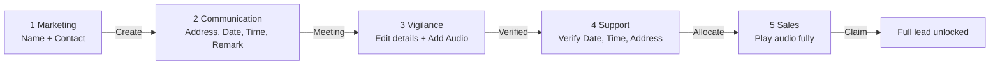
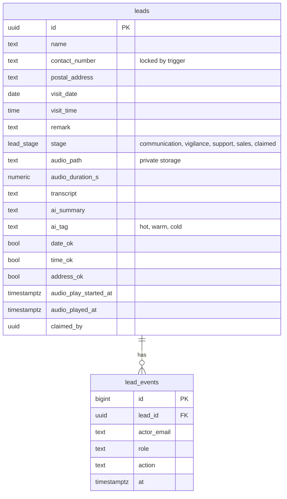

# Vibh-Anu Lead CRM

A working CRM prototype for the Vibh-Anu Junior AI Software Developer assessment. One lead moves through five departments, each with its own login, and a call recording travels with it from Vigilance to Sales.

**Live:** https://vibhanu-crm.vercel.app

## The workflow



| Department | Can do | Cannot do |
|---|---|---|
| Marketing | Create a lead (name, contact number) | See other stages |
| Communication | Edit name, add postal address, date, time, remark, then **Meeting** | Change the contact number |
| Vigilance | Edit all details, upload the call recording (mandatory), then **Verified** | Verify without audio, change the contact number |
| Support | Tick date, time and complete address, then **Allocate** | Allocate before all 3 checks |
| Sales | Play the recording completely, then **Claim** to see the full lead | Skip, speed up, or claim before the recording ends |

## How the audio works

1. **Added:** Vigilance picks the file (`.aac`, `.mp3`, `.m4a`, `.wav`, `.ogg`, `.webm`). The browser uploads it straight to storage using a one-time signed upload URL, so large files never pass through the web server.
2. **Stored:** files live in a **private** Supabase Storage bucket (`call-recordings/leads/<lead id>/`). There is no public link. Replacing a recording deletes the old file.
3. **Accessed:** pages get a short-lived signed URL (5 to 10 minutes). An expired link stops working.
4. **Used by Sales:** the player has no seek bar and is locked to 1x speed. The server records when playback started and only accepts "played fully" if the real elapsed time is at least 95% of the recording length. Claim is checked again on the server, so the button cannot be forced.

## AI features

When Vigilance uploads a recording, the browser converts it to 16 kHz mono WAV, and the server sends it to:

- **Whisper large v3 turbo** (via Groq) for the transcript, with a spelling hint for names like "Vibhavangal Anukulakara".
- **gpt-oss-120b** (via Groq) for a 2 to 3 sentence English summary and a **hot / warm / cold** interest tag.

If AI fails, the recording is still saved and the workflow continues. Sales sees the transcript and summary only after claiming.

## Security

- **Roles** are stored in Supabase `app_metadata`, which only the server can change.
- **Row Level Security** is on for every table with no client policies. A browser using the public key reads 0 rows. All reads and writes go through server actions that check the user's role first.
- **Route guard:** `proxy.ts` sends each department back to its own page. Each page and each action checks the role again.
- **Contact number lock** is a database trigger, so no API call can change it after creation.
- **Atomic hand-offs:** every move updates `where stage = <expected>`, so a lead cannot be moved twice or skip a step.
- **Masked data:** before claiming, Sales only receives the name and a masked number (`98xxxxxx56`), masked on the server.
- **Audit trail:** every action is written to `lead_events` and shown as an activity log on the lead.

## Database



Full schema: [`supabase/schema.sql`](supabase/schema.sql).

## Stack

Next.js 16 (App Router, server actions, TypeScript), Tailwind CSS 4, Supabase (Postgres, Auth, Storage), Groq (Whisper + LLM), Vercel.

## Code map

| File | What it does |
|---|---|
| `lib/workflow.ts` | The whole workflow as one table: who works on which stage, the next stage, editable fields. Pure and unit tested |
| `app/actions.ts` | Every server action (create, save, upload, verify, allocate, listen, claim) with role checks |
| `proxy.ts` | Session refresh and role-based routing |
| `components/forms.tsx` | Client forms, audio uploader (WAV conversion), Sales listen gate |
| `lib/ai.ts` | Transcript, summary and tag |
| `supabase/schema.sql` | Tables, trigger, RLS, storage bucket |

## Run locally

```bash
npm install
cp .env.example .env.local   # fill in Supabase + Groq keys
# run supabase/schema.sql once in the Supabase SQL editor
npm run seed                 # creates the 5 department logins
npm run dev
npm test                     # workflow rules
npm run reset                # wipes all leads and recordings
```

## How AI tools were used

Built with Claude Code as the AI development tool. I gave it the brief, chose the stack and features, reviewed the plan, and tested every step of the flow in the browser. Bugs caught during testing included a build crash from an API client created at import time, Whisper misspelling the company name (fixed with a vocabulary prompt), and a retired Groq model (switched to gpt-oss-120b).
