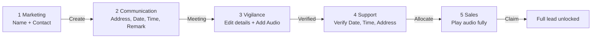
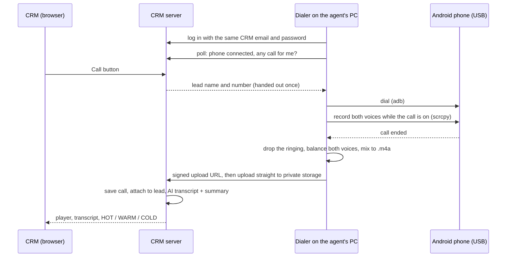
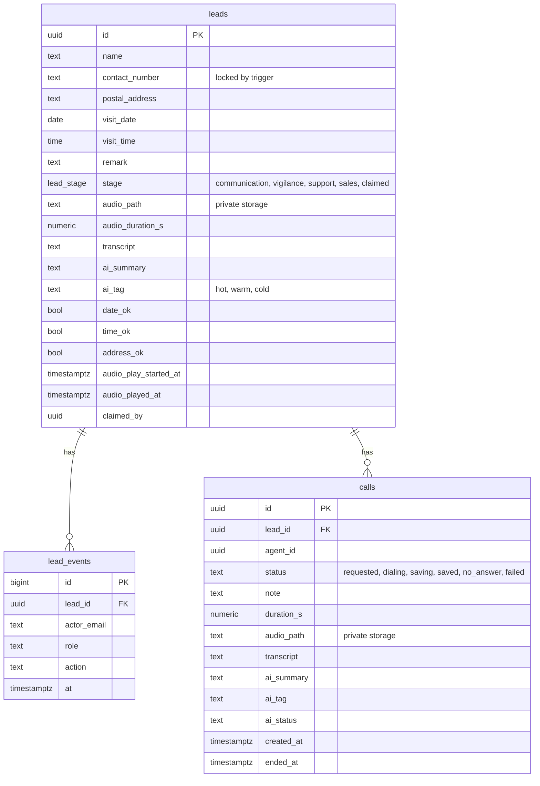

# Vibh-Anu Lead CRM

A working CRM with a dialer, built for the Vibh-Anu Junior AI Software Developer assessment. One lead moves through five departments, each with its own login. Calls are made from the CRM, recorded automatically and saved on the lead.

**Live:** https://vibhanu-crm.vercel.app

## The workflow



| Department | Can do | Cannot do |
|---|---|---|
| Marketing | Create a lead (name, contact number) | See other stages |
| Communication | Edit name, add postal address, date, time, remark, then **Meeting** | Change the contact number |
| Vigilance | Edit all details, upload the call recording (mandatory), then **Verified** | Verify without audio, change the contact number |
| Support | Tick date, time and complete address, then **Allocate** | Allocate before all 3 checks |
| Sales | Play the recording completely, then **Claim** to see the full lead | Skip, speed up, or claim before the recording ends |

## Dialer with automatic call recording

Click **Call** in the CRM and the agent's own phone dials from its SIM. The call is recorded without pressing anything, and the recording, transcript and AI summary appear on the lead.



| Task | How |
|---|---|
| CRM login in the dialer | Same Supabase users. The dialer keeps its token in memory only |
| Make calls | From the CRM screen or from the lead list in the dialer window |
| Auto recording | Starts when the phone starts dialing, stops when the call ends. Customer and agent arrive on separate channels |
| Save in CRM | One row per call in `calls`: agent, time, duration, status, recording, transcript, summary |

Why not record in the browser or in a phone app: a web page cannot place a phone call, and since Android 10 normal apps cannot record one. A USB connection with debugging allowed by the phone's owner can.

**When things go wrong**
- USB cable drops during a call: the call goes on, recording continues as a second part and both parts are joined.
- No internet: the recording stays on the PC and is uploaded later.
- Not answered, busy, or no recording: saved in the call history with the reason.
- The agent cannot start a second call while one is running (unique index in the database).

**Safety**
- Only the department holding a lead can call it. Sales must claim first, because the number is masked until then.
- The number is checked again (10 digit Indian mobile) before it reaches the phone.
- The numbers of the made-up demo leads are blocked from dialing.
- The dialer window only listens on `127.0.0.1` and refuses requests from other websites.
- The CRM reminds the agent to tell the customer that the call is recorded.

**Start the dialer** (Windows, Node 20+, ffmpeg in PATH): unzip [scrcpy](https://github.com/Genymobile/scrcpy/releases) into `dialer/bin`, turn on USB debugging on the phone, then run `npm run dialer` or double-click `dialer/Start Dialer.cmd`. Set `CRM_URL=http://localhost:3000` to test against a local CRM.

**For a bigger team:** the recording side (`dialer/`) can be replaced by a cloud telephony provider such as Exotel. The `calls` table, the call history and the AI step stay the same.

## How the audio works

1. **Added:** by the dialer after a call (see above), or Vigilance picks the file (`.aac`, `.mp3`, `.m4a`, `.wav`, `.ogg`, `.webm`). The browser uploads it straight to storage using a one-time signed upload URL, so large files never pass through the web server.
2. **Stored:** files live in a **private** Supabase Storage bucket (`call-recordings/leads/<lead id>/`). There is no public link. Replacing a recording deletes the old file.
3. **Accessed:** pages get a short-lived signed URL (5 to 10 minutes). An expired link stops working.
4. **Used by Sales:** the player has no seek bar and is locked to 1x speed. The server records when playback started and only accepts "played fully" if the real elapsed time is at least 95% of the recording length. Claim is checked again on the server, so the button cannot be forced.

## AI features

Dialer recordings go to the AI as they are. When Vigilance uploads a file, the browser first converts it to 16 kHz mono WAV. The server sends it to:

- **Whisper large v3** (via Groq) for the transcript, with a spelling hint for names like "Vibhavangal Anukulakara".
- **gpt-oss-120b** (via Groq) for a 2 to 3 sentence English summary and a **hot / warm / cold** interest tag.

**Hindi and Hinglish:** most customers mix Hindi and English, so this was tested on a real Hinglish call. The faster "turbo" model sometimes turned Hindi into wrong English. The large model with Hindi set as the language and an English hint kept each language as spoken in 3 of 3 runs, and a pure English test recording still came out right. The summary prompt also knows Hindi amounts (dedh crore = 1.5 crore, pauna crore = 75 lakh) and is told to quote an unclear number instead of guessing.

If AI fails, the recording is still saved and the workflow continues. Sales sees the transcript and summary only after claiming.

## Security

- **Roles** are stored in Supabase `app_metadata`, which only the server can change.
- **Row Level Security** is on for every table with no client policies. A browser using the public key reads 0 rows. All reads and writes go through server actions that check the user's role first.
- **Route guard:** `proxy.ts` sends each department back to its own page. Each page and each action checks the role again.
- **Contact number lock** is a database trigger, so no API call can change it after creation.
- **Atomic hand-offs:** every move updates `where stage = <expected>`, so a lead cannot be moved twice or skip a step.
- **Masked data:** before claiming, Sales only receives the name and a masked number (`98xxxxxx56`), masked on the server.
- **Audit trail:** every action is written to `lead_events` and shown as an activity log on the lead.

## Database



Full schema: [`supabase/schema.sql`](supabase/schema.sql).

## Stack

Next.js 16 (App Router, server actions, TypeScript), Tailwind CSS 4, Supabase (Postgres, Auth, Storage), Groq (Whisper + LLM), Vercel. Dialer: Node.js, adb, scrcpy, ffmpeg.

## Code map

| File | What it does |
|---|---|
| `lib/workflow.ts` | The whole workflow as one table: who works on which stage, the next stage, editable fields. Pure and unit tested |
| `app/actions.ts` | Every server action (create, save, upload, verify, allocate, listen, claim) with role checks |
| `proxy.ts` | Session refresh and role-based routing |
| `components/forms.tsx` | Client forms, audio uploader (WAV conversion), Sales listen gate |
| `lib/calls.ts` | Call rules: who may call, one call at a time, save the recording, run the AI |
| `app/api/dialer/route.ts` | API used by the PC dialer (login, poll, upload, save) |
| `components/dialer.tsx` | Dialer panel in the CRM: Call button, live status, call history |
| `dialer/connector.mjs` | The PC dialer: CRM login, one call from start to finish, upload queue, its window |
| `dialer/phone.mjs` | Phone control: dial, call state, hang up, record, mix |
| `lib/ai.ts` | Transcript, summary and tag |
| `supabase/schema.sql` | Tables, trigger, RLS, storage bucket |

## Run locally

```bash
npm install
cp .env.example .env.local   # fill in Supabase + Groq keys
# run supabase/schema.sql once in the Supabase SQL editor
npm run seed                 # creates the 5 department logins
npm run dev
npm test                     # workflow and phone rules
npm run dialer               # the PC dialer (phone on USB)
npm run reset                # wipes all leads and recordings
```

## How AI tools were used

Built with Claude Code as the AI development tool. I gave it the brief, chose the stack and features, reviewed the plan, and tested every step of the flow in the browser. Bugs caught during testing included a build crash from an API client created at import time, Whisper misspelling the company name (fixed with a vocabulary prompt), a retired Groq model (switched to gpt-oss-120b), a crash on a broken login token in the dialer API, and a speech model that turned Hindi into wrong English (compared settings on a real call and switched).
